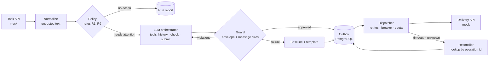
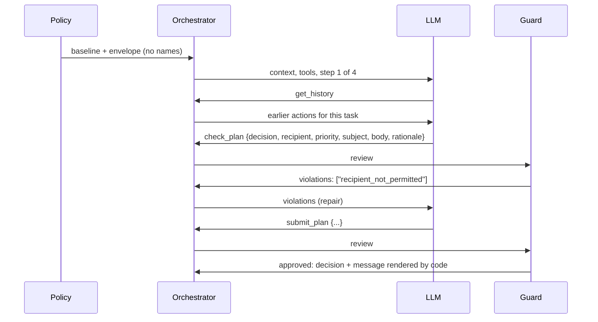

# TechCom AI Operations & Follow-up Service


A Python service that reads project tasks, decides which ones need
attention, lets an **LLM orchestrate the follow-up inside limits set by
code**, and delivers the resulting messages **idempotently**, even when
APIs throttle, fail, or time out after a successful write.

```text
rules decide WHETHER to act  →  the LLM plans HOW, inside an envelope
→  a deterministic guard approves  →  the outbox delivers idempotently
```

---

## Contents

- [Quick start](#quick-start)
- [How it works](#how-it-works)
- [The LLM orchestrator and how it is kept in check](#the-llm-orchestrator-and-how-it-is-kept-in-check)
- [Required scenarios](#required-scenarios)
- [Output on the supplied fixture](#output-on-the-supplied-fixture)
- [Commands and configuration](#commands-and-configuration)
- [Quality and evidence](#quality-and-evidence)
- [Assumptions and trade-offs](#assumptions-and-trade-offs)
- [Not implemented, and why](#not-implemented-and-why)
- [What changes for production](#what-changes-for-production)
- [Documentation](#documentation)

---

## Quick start

Requirements: Python 3.13 or 3.14 and [uv](https://docs.astral.sh/uv/).
Docker is only needed for the PostgreSQL tests and the optional stack.

```sh
uv sync --locked
make demo                      # mock API + full workflow + rerun, offline
cat var/demo/decisions.json    # ten explainable decisions, seven messages
cat var/demo/delivery_log.jsonl
```

`make demo` starts a local mock API, processes `fixtures/tasks.json` for
`2026-10-21`, plans and sends seven follow-ups, reconciles any uncertain
send, then processes the same data again: **seven duplicates, zero new
sends**. No database, Docker or API key is needed; the LLM runs on a
deterministic offline model that speaks the real tool protocol.

Other entry points:

```sh
uv run followup run --fixture fixtures/tasks.json --as-of 2026-10-21 --dry-run
make test-fast                 # offline tests, no Docker
make test                      # full suite with PostgreSQL 18, 100 % branch gate
```

To use a real model, set `FOLLOWUP_LLM_PROVIDER=router` and an OpenAI
key (`FOLLOWUP_OPENAI_API_KEY`); routes and prices are in
[`config/llm.toml`](config/llm.toml).

---

## How it works



1. **Ingestion.** Records from the mock API are normalized: IDs, status
   synonyms, owners, dates, notes. Notes are `UntrustedText`, cleaned of
   control characters and screened for prompt injection.
2. **Policy.** An ordered rule table decides from dates and status whether
   a task needs a follow-up, an ETA request, a clarification or an
   escalation, and computes a **baseline** action. Ambiguous notes are
   classified by an LLM with verbatim evidence; the model never sets
   owners, dates or status.
3. **Orchestration.** For every new actionable task state, the LLM plans
   the action with read-only tools inside an envelope computed by code
   (next section).
4. **Outbox.** The decision, the action and its audit receipt are written
   in one transaction. The idempotency key comes from the task state and
   the baseline, so a rerun or a different model answer cannot create a
   second message.
5. **Delivery.** Dispatchers claim rows with `SKIP LOCKED` and fencing
   tokens, send with a stable `Idempotency-Key`, retry with bounded
   backoff, and treat a timeout as **unknown**: the reconciler looks the
   operation up before anything is resent.

---

## The LLM orchestrator and how it is kept in check

Security boundary: the model selects exact reviewed subject/body pairs
for its chosen action; arbitrary prose is rejected. Names, dates and
other facts are rendered by code. Titles and project labels are omitted
from model context, contact data is redacted from notes, and every
tracker text surface is screened. This is contact minimisation, not
guaranteed anonymisation. The code records a bounded, code-owned rationale.

Notification slots additionally enforce one action per source task state,
independent of interpreter failures or changing model answers. Existing
operation IDs stay unchanged. PostgreSQL migration 0006 backfills from
decision receipts and refuses upgrades with unrecoverable old tombstones.
See [ADR-0017](docs/adr/0017-llm-output-and-notification-boundaries.md).

The assignment asks for an LLM that interprets notes and drafts messages
without inventing facts. This service goes further: the model
**orchestrates the follow-up** (it chooses the action, the recipient, the
priority and the wording, and can escalate an previously notified overdue task), while
every step is constrained, validated and audited by code.

### What the model decides, and what code decides

| Code (deterministic) | LLM (bounded judgement) |
|----------------------|-------------------------|
| Whether a task needs attention at all | Which allowed action fits: follow up, request an ETA, clarify, escalate |
| The envelope of allowed actions and recipients | Which allowed recipient: owner, coordinator, manager, assigned team |
| Every fact: names, dates, IDs, days overdue | Priority (it may raise it, never lower it) |
| Deduplication, delivery, retries | One of the reviewed message phrasings |
| Final approval of the plan | A proposed choice and evidence quoted from the note |

### The loop



Tools are **read-only**: `get_history`, `check_plan`, `submit_plan`.
Nothing the model does sends a message, changes a task or reaches the
network. The outbox is the only executor.

### The envelope

| Baseline from the rules | Alternatives the model may choose |
|-------------------------|-----------------------------------|
| follow up with the owner | escalate to the project manager, **only if** an earlier action for the task was sent and it is still overdue |
| request an ETA from the assigned team | ask the owner; escalate under the same condition |
| clarify missing data | send it to the project coordinator |
| escalate to the manager | address the coordinator; never downgrade |
| no action | the model is not called |

First contacts therefore always follow the brief's routing; the model's
extra authority is to chase an previously notified overdue task up the chain.

### The guard

Every proposal is reviewed by [`domain/guard.py`](src/techcom_followup/domain/guard.py)
before it can become an action. It rejects, with closed violation codes:

- a decision or recipient outside the envelope, or a lowered priority;
- facts written as text instead of placeholders: names, dates, numbers,
  links, e-mail addresses, phone numbers;
- claims that a status changed, instruction-like text, copied note text,
  a missing `{task_id}`;
- an empty, linked or instruction-like rationale, and evidence that is
  not a verbatim quote of at least eight characters from the note.

Code renders placeholders such as `{recipient_name}` and `{due_date}`
from task data; the model only chooses words.

### Failure handling and budgets

- At most **four steps** per plan; on the last one the model must submit.
- Invalid JSON, an unknown tool, a timeout, an open circuit breaker, an
  exhausted daily budget or a plan that never passes the guard all fall
  back to the **baseline action and its template** (`llm_fallback` flag).
- A note is **withheld** if notes, title or project contain screened instructions.
- Recipients are opaque references; display fields are omitted and contacts in notes are redacted. Notes can still contain personal names.
- Each plan stores the baseline next to the chosen decision, a bounded
  rationale, and an audit trace with the tools used, step count,
  violation codes and outcome, in the same transaction as the decision.

### How containment is proven

| Evidence | What it shows |
|----------|---------------|
| [`tests/property/test_agent_containment.py`](tests/property/test_agent_containment.py) | Hypothesis feeds arbitrary and hostile model outputs (fake tools, foreign recipients, `close_task`, injections, links, invented dates); every result is inside the envelope or is the baseline |
| [`tests/unit/domain/test_guard.py`](tests/unit/domain/test_guard.py) | Each escape attempt maps to a closed violation code |
| [`tests/unit/processing/test_orchestrator.py`](tests/unit/processing/test_orchestrator.py) | Repair loop, step budget, final-step rule, withheld notes, fallbacks, escalation after an unanswered follow-up |
| [`tests/unit/processing/test_planned_processing.py`](tests/unit/processing/test_planned_processing.py) | A model that answers differently on every call still produces one action per task state; reruns make no model calls |
| [`tests/eval/`](tests/eval/README.md) | Replay evaluation of note interpretation: 95 cases including 32 injections, macro-F1 0.99, zero unsafe outcomes (synthetic recordings) |

Design record: [ADR-0016](docs/adr/0016-bounded-llm-orchestrator.md).
`FOLLOWUP_LLM_PLANNER=templates` switches the orchestrator off.

---

## Required scenarios

| Scenario from the brief | Behaviour | Test |
|-------------------------|-----------|------|
| Overdue, no explanation | Follow-up to the owner | `tests/scenarios/test_processing.py::test_s1…` |
| Overdue, blocked by materials | `request_eta` to the warehouse team | `…::test_s2…` |
| Completed task | No action | `…::test_s3_done…` |
| Missing owner or due date | Clarification to the owner or project coordinator | `…::test_s3_missing…` |
| Second run, unchanged data | Duplicates suppressed, nothing sent | `…::test_s4…`, `make demo` |
| 429 / transient 5xx | Bounded retries with jittered backoff and `Retry-After` | `…::test_s5…` |
| Timeout after a committed write | Outcome `unknown` → lookup by operation id → no resend | `…::test_s6…` |
| Malformed LLM JSON | Validation failure → baseline and template | `tests/scenarios/test_llm_safety.py`, `tests/unit/processing/test_orchestrator.py` |
| Prompt injection in a note | Flagged, withheld from the model, decision from dates and status | `tests/scenarios/test_llm_safety.py`, `tests/eval/` |

Faults can be injected into the mock, for example
`FOLLOWUP_MOCK_FAULTS=tasks:429@1,messages:timeout_after_commit@1 make mock`.

---

## Output on the supplied fixture

| Task | Decision | Recipient | Why |
|------|----------|-----------|-----|
| TC-1001 | follow_up_owner | John Smith | 3 days overdue, no explanation |
| TC-1002 | request_eta | Warehouse team | blocked by materials |
| TC-1003 | no_action | — | done |
| TC-1004 | clarify_missing_info | Wisconsin Build coordinator | no owner |
| TC-1005 | clarify_missing_info | Alex Brown | no due date |
| TC-1006 | follow_up_owner + `prompt_injection_suspected` | Jamie Lee | note withheld, decided from dates |
| TC-1007 | no_action | — | on track |
| TC-1008 | escalate | SURF Illinois project manager | blocked upstream, 6 days overdue |
| TC-1009 | request_eta | Warehouse team | materials, due today |
| TC-1010 | no_action | — | done |

A record from [`samples/decisions.json`](samples/decisions.json):

```json
{
  "task_id": "TC-1002",
  "decision": "request_eta",
  "target": {"kind": "team", "name": "Warehouse team", "project": "SURF Illinois"},
  "rule_id": "R5+agent",
  "baseline": {"decision": "request_eta", "rule_id": "R5"},
  "reason": "Blocked by materials; 3 day(s) overdue; delivery date unknown.",
  "rationale": "Selected request_eta for assigned_team within the policy envelope.",
  "flags": ["agent_planned"],
  "message": {
    "subject": "Delivery ETA needed for TC-1002: Install handholes",
    "body": "Hello Warehouse team, TC-1002 'Install handholes' (SURF Illinois) is waiting on materials and is due 2026-10-18. Could you confirm when the delivery will arrive, or tell us who can?",
    "source": "llm"
  },
  "outcome": "enqueued"
}
```

The mock delivery log is [`samples/delivery_log.jsonl`](samples/delivery_log.jsonl);
the full run with outbox states is [`samples/run_report.json`](samples/run_report.json).

---

## Commands and configuration

| Command | What it does |
|---------|--------------|
| `followup run --fixture … --dry-run` | Decisions and messages, no persistence, delivery or LLM calls |
| `followup run --dispatch` | Process, then send due actions |
| `followup dispatch --limit 50` | Send due actions (PostgreSQL) |
| `followup reconcile --limit 50` | Resolve uncertain sends by lookup |
| `followup report --run-id …` | Decisions and outbox states of a run |
| `followup maintenance prune` | Apply retention (maintenance role) |
| `followup-api` | Optional authenticated REST API ([docs/19](docs/19-api-and-deployment.md)) |

| Variable | Default | Meaning |
|----------|---------|---------|
| `FOLLOWUP_LLM_PROVIDER` | `stub` | `stub` (offline) or `router` (OpenAI Responses API) |
| `FOLLOWUP_LLM_PLANNER` | `agent` | `agent` (bounded orchestrator) or `templates` |
| `FOLLOWUP_DATABASE_URL` | unset | PostgreSQL; memory storage when unset |
| `FOLLOWUP_DISPATCH_ENABLED` | `true` | Kill switch for new sends |
| `FOLLOWUP_WRITE_CONCURRENCY` | `8` | Concurrent planning and writes per batch (1–16) |
| `FOLLOWUP_RECIPIENT_DAILY_LIMIT` | `20` | Messages per recipient per UTC day |
| `FOLLOWUP_OPENAI_API_KEY` | unset | Only for `router`; never committed |

Thresholds, routing and status synonyms live in [`config/`](config/).
[`.env.example`](.env.example) lists the non-secret settings.

---

## Quality and evidence

| Gate | Result |
|------|--------|
| Tests | 1,100+ unit, property, contract, scenario and integration tests |
| Coverage | 100 % statements and branches (application and mock) |
| Static checks | Ruff `ALL` (79 columns), mypy `--strict`, Bandit, import-linter (hexagonal layers) |
| Mutation testing | mutmut on policy, identity and messages |
| LLM evaluation | Replay harness, 95 cases, macro-F1 0.99, unsafe outcomes 0 |
| 10,000 tasks | 78.9 s first run, 53.2 s rerun, 200 MB, PostgreSQL 18 ([benchmarks](docs/benchmarks.md)) |
| Security | OWASP ASVS 5.0 L2 as the design target, OWASP LLM Top 10 controls, least-privilege DB roles ([docs/15](docs/15-security-asvs-l2.md)) |

Architecture: a hexagonal layout with a pure domain core
(`domain/`), use cases (`application/`), adapters for HTTP, PostgreSQL,
OpenAI and the CLI (`adapters/`), and composition in `bootstrap.py`.

---

## Assumptions and trade-offs

- **Evaluation date** is an explicit input (`--as-of`), UTC calendar days.
- **One follow-up per task state.** The dedupe key covers task, action,
  recipient and the decision-relevant state (status, due date, owner,
  notes); touching `last_update` alone does not re-notify.
- **Strict dates.** Only ISO dates are accepted; anything else counts as
  missing and triggers a clarification instead of a guess.
- **PostgreSQL instead of a broker.** The outbox, `SKIP LOCKED` claims and
  advisory locks cover the workload without Redis or Celery (ADR-0002).
- **Placeholders over free facts.** The model writes prose but cannot
  type a date or a name; this costs some style and removes a whole class
  of hallucinations.
- **Per-decision transactions.** Simple to reason about and atomic; it is
  the main cost in the 10k benchmark.

---

## Not implemented, and why

| Item | Reason |
|------|--------|
| Real task tracker and e-mail/SMS provider | The brief asks for a mock API and forbids real messages; both sit behind ports |
| Re-reminders on an unchanged task | Needs a product decision on cadence and quiet hours |
| Human approval queue for escalations | A UI/workflow feature; the envelope already limits escalation to unanswered, overdue tasks |
| Measured quality on a real LLM provider | No labelled real notes; the evaluation harness and an opt-in live test are ready |
| Cross-process LLM spend ledger | The budget is per process; it belongs next to the PostgreSQL recipient quota |
| Real identity provider, internal TLS | Tokens are verified with configured keys; TLS is a deployment concern |
| 60 s / 30 s targets for 10,000 tasks | Would need batched multi-row writes; current speed is 1,000× the stated volume |

Details: [docs/08](docs/08-implementation-plan.md).

---

## What changes for production

1. Real tracker and messaging adapters behind the existing ports.
2. TLS gateway and IdP-issued service tokens for the API.
3. Calibrate the orchestrator on labelled real notes; record provider
   responses into the evaluation harness and gate prompt changes on it.
4. A shared LLM spend ledger in PostgreSQL.
5. Re-reminder cadence and an approval queue once product rules exist.

---

## Documentation

| Document | Content |
|----------|---------|
| [00 Requirements](docs/00-requirements-analysis.md) | Requirements, scenarios, fixture analysis, assumptions |
| [02 Architecture](docs/02-architecture.md) | Layers, data flow, schema, configuration |
| [04 Decision policy & LLM](docs/04-decision-policy-and-llm.md) | Rule table, LLM contracts, orchestrator envelope |
| [05 Reliability](docs/05-reliability.md) | Identity, transactions, retries, reconciliation, failure modes |
| [06 Test strategy](docs/06-test-strategy.md) | Test pyramid, properties, coverage policy |
| [08 Scope and status](docs/08-implementation-plan.md) | What is done, what is not and why |
| [09 Operations at scale](docs/09-operations-at-scale.md) | 10,000 tasks/day, cost, monitoring, access |
| [15 Security](docs/15-security-asvs-l2.md) | ASVS 5.0 L2, OWASP API and LLM Top 10 |
| [18 Runbook](docs/18-runbook.md) | Alerts, levers, backup and restore |
| [19 API and deployment](docs/19-api-and-deployment.md) | Authenticated API, runtime configuration |
| [ADRs](docs/adr/) | Architecture decisions 0001–0016 |

Time spent: about six hours of focused work over several sessions. AI
coding assistants were used, as the brief allows.
