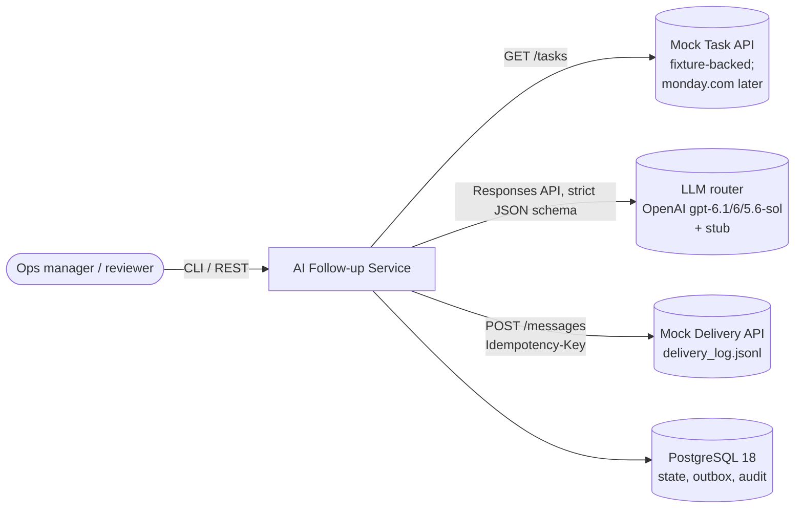
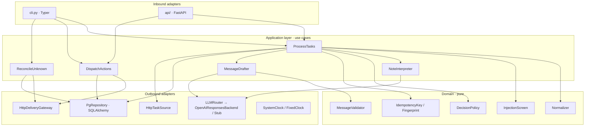
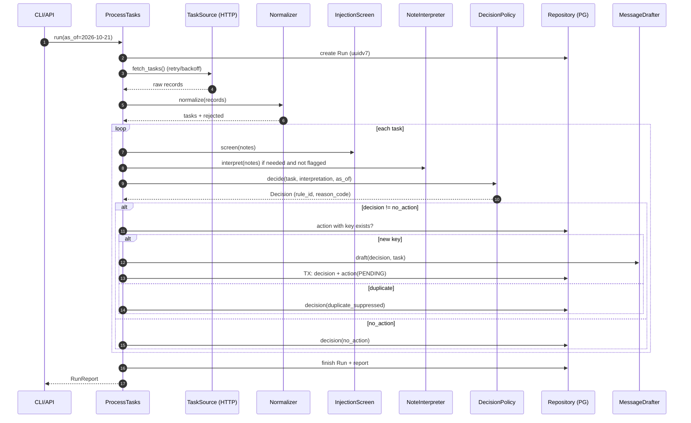

# 02 — Architecture

## 1. Architectural style (and why)

**Hexagonal architecture (Ports & Adapters) with a functional core and an
imperative shell, packaged as a small modular monolith.**

| Option considered | Verdict | Reason |
|-------------------|---------|--------|
| Single script / notebook-style | ✗ | Cannot demonstrate reliability, testability or swap-ability; fails "code structure". |
| Full DDD + CQRS + event sourcing | ✗ | Over-engineering for ~10 entities and a 4-hour brief; slows live changes. |
| Microservices + Celery/Redis | ✗ | Brief says not required; adds infra with no benefit at 10k/day. PostgreSQL already gives us a durable queue (`FOR UPDATE SKIP LOCKED`). |
| **Hexagonal, functional core** | ✓ | Domain policy is pure and exhaustively testable; every external system (task API, LLM, delivery, DB, clock) sits behind a port, so faults can be injected deterministically and monday.com can replace the fixture without touching the domain. |

Dependency rule: `adapters → application → domain`. The domain imports
nothing from the project except itself and the standard library + Pydantic.
Enforced by `import-linter` contracts in CI.

## 2. C4 — System context



## 3. C4 — Containers (Docker Compose)

| Container | Tech | Responsibility |
|-----------|------|----------------|
| `app` | Python 3.14 image (code supports ≥ 3.13), FastAPI + Typer | Runs pipeline, dispatcher, REST API, metrics. |
| `mock-api` | Separate `mock` image target, `techcom_mocks` workspace package (FastAPI); never deployed | Serves `tasks.json` (`GET /v1/tasks`) and receives messages (`POST /v1/messages`, `GET /v1/messages/{operation_id}`); scripted fault injection. |
| `db` | `postgres:18` | Runs, decisions, actions (outbox), LLM cache, audit events. |

## 4. Components (inside `app`)



## 5. Source layout (src layout, single distribution)

```text
.
├── pyproject.toml              # uv project, ruff, mypy, pytest, coverage
├── uv.lock
├── Makefile                    # bootstrap, lint, type, test, demo
├── compose.yaml                # db (postgres:18), migrate, mock-api, app
├── compose.observability.yaml  # Prometheus, Grafana, Loki, Alloy
├── Dockerfile                  # targets: runtime (prod), mock (demo)
├── .gitignore  .dockerignore  .env.example  .pre-commit-config.yaml
├── deploy/                     # prometheus, grafana, loki, alloy, initdb
├── config/
│   ├── routing.toml            # project → coordinator/manager, blocker → team
│   └── policy.toml             # rule thresholds, policy version
├── fixtures/tasks.json
├── migrations/                 # Alembic (sync psycopg 3)
├── samples/                    # committed demo outputs
│   ├── decisions.json
│   ├── run_report.json
│   ├── delivery_log.jsonl
│   └── audit_log.jsonl
├── src/
│   ├── techcom_followup/
│   │   ├── domain/
│   │   │   ├── models.py       # Task, Decision, ActionRecord, enums
│   │   │   ├── text.py         # NFKC, control/format char stripping
│   │   │   ├── normalize.py    # raw dict → Task | RejectedRecord
│   │   │   ├── policy.py       # ordered rule table, pure
│   │   │   ├── interpretation.py  # NoteInterpretation, keyword prefilter
│   │   │   ├── injection.py    # untrusted-text screen
│   │   │   ├── identity.py     # fingerprint, idempotency key, UUIDv5 op id
│   │   │   └── messages.py     # templates, placeholder render, validator
│   │   ├── application/
│   │   │   ├── ports.py        # typing.Protocol interfaces
│   │   │   ├── process_tasks.py
│   │   │   ├── dispatch.py
│   │   │   ├── reconcile.py
│   │   │   ├── interpreter.py  # cache + breaker + validation + fallback
│   │   │   └── drafter.py
│   │   ├── adapters/
│   │   │   ├── inbound/{cli.py, api/}
│   │   │   └── outbound/{task_source_http.py, delivery_http.py,
│   │   │                 llm/{router,openai_responses,catalog,config,factory}.py,
│   │   │                 llm_stub.py, pg_repository.py,
│   │   │                 orm.py, clock.py}
│   │   └── infrastructure/
│   │       ├── settings.py     # pydantic-settings
│   │       ├── policy_files.py # policy.toml / routing.toml loaders
│   │       ├── http_client.py  # httpx factory, allow-list, retry policy
│   │       ├── resilience.py   # circuit breaker, retry budget
│   │       ├── log_config.py   # structlog JSON + OTLP, redaction
│   │       ├── security.py     # JWT validation, scopes, headers, limits
│   │       ├── metrics.py      # prometheus-client
│   │       └── container.py    # composition root (manual DI)
├── mocks/                      # uv workspace member (not in prod image)
│   └── src/techcom_mocks/
│       ├── app.py              # mock Task + Delivery API
│       └── faults.py           # deterministic fault plan
└── tests/
    ├── unit/  ├── property/  ├── contract/
    ├── integration/  ├── scenarios/  └── golden/
```

Dependency injection is **manual** (a ~60-line composition root). A DI
framework would be extra magic to explain in a 30-minute review.

## 6. Run pipeline (data flow)



The dispatcher runs as a separate step (`followup dispatch`) or right after
the run (`followup run --dispatch`). This split is the transactional outbox:
**deciding** and **sending** are never in the same transaction.

## 7. Persistence model (PostgreSQL 18)

```sql
-- Native uuidv7(): time-ordered keys, index-friendly (PostgreSQL 18).
CREATE TYPE action_status AS ENUM
    ('pending', 'in_flight', 'unknown', 'sent', 'dead');

CREATE TABLE runs (
    id              uuid PRIMARY KEY DEFAULT uuidv7(),
    as_of           date        NOT NULL,
    policy_version  text        NOT NULL,
    started_at      timestamptz NOT NULL DEFAULT now(),
    finished_at     timestamptz,
    stats           jsonb       NOT NULL DEFAULT '{}'::jsonb
);

CREATE TABLE decisions (
    id              uuid PRIMARY KEY DEFAULT uuidv7(),
    run_id          uuid NOT NULL REFERENCES runs(id),
    task_id         text NOT NULL,
    decision        text NOT NULL,
    rule_id         text NOT NULL,
    reason_code     text NOT NULL,
    reason          text NOT NULL,
    target          jsonb,
    flags           text[] NOT NULL DEFAULT '{}',
    state_fingerprint text NOT NULL,
    idempotency_key text,
    outcome         text NOT NULL,   -- enqueued | duplicate_suppressed | none
    llm_used        boolean NOT NULL DEFAULT false,
    UNIQUE (run_id, task_id)
);

-- The actions table *is* the outbox.
CREATE TABLE actions (
    id               uuid PRIMARY KEY DEFAULT uuidv7(),
    idempotency_key  text NOT NULL UNIQUE,
    operation_id     uuid NOT NULL UNIQUE,     -- UUIDv5(key), sent as header
    task_id          text NOT NULL,
    decision_id      uuid NOT NULL REFERENCES decisions(id),
    target           jsonb NOT NULL,
    message          jsonb NOT NULL,           -- subject, body, template_id
    status           action_status NOT NULL DEFAULT 'pending',
    attempts         int  NOT NULL DEFAULT 0,
    next_attempt_at  timestamptz NOT NULL DEFAULT now(),
    lease_until      timestamptz,
    last_error       text,
    provider_ref     text,
    created_at       timestamptz NOT NULL DEFAULT now(),
    sent_at          timestamptz
);
CREATE INDEX actions_due_idx ON actions (status, next_attempt_at)
    WHERE status IN ('pending', 'unknown');

CREATE TABLE llm_cache (
    cache_key      text PRIMARY KEY,   -- sha256(model|prompt_ver|input)
    model          text NOT NULL,
    prompt_version text NOT NULL,
    response       jsonb NOT NULL,
    created_at     timestamptz NOT NULL DEFAULT now()
);

CREATE TABLE audit_events (
    id        uuid PRIMARY KEY DEFAULT uuidv7(),
    run_id    uuid,
    task_id   text,
    kind      text NOT NULL,
    payload   jsonb NOT NULL,
    at        timestamptz NOT NULL DEFAULT now()
);
```

Why these constraints matter:

* `actions.idempotency_key UNIQUE` + `INSERT … ON CONFLICT DO NOTHING
  RETURNING id` is the **single source of truth for dedupe** — race-safe even
  with concurrent runs, not a read-then-write check.
* `operation_id` is derived (UUIDv5), so even after a database restore the
  same logical action produces the same header and the receiver dedupes.
* Claiming work: `UPDATE actions SET status='in_flight', lease_until=now()+…
  WHERE id IN (SELECT id … FOR UPDATE SKIP LOCKED LIMIT n) RETURNING *` —
  multiple dispatchers never double-send; expired leases are recovered.

## 8. Inbound interfaces

**CLI (Typer)** — primary demo surface:

```text
followup run       --as-of 2026-10-21 [--dispatch] [--output samples/]
followup dispatch  [--max-batch 50]
followup reconcile
followup report    --run-id <uuid>
followup demo      # migrate → run → dispatch → rerun → print summary
```

**REST (FastAPI, short-lived service JWT with scopes — see `15` §2 D1,
§5)** — "runnable service":

| Method | Path | Purpose |
|--------|------|---------|
| POST | `/v1/runs` | Trigger a run (`as_of`, `dispatch` flag); returns `RunReport`. |
| GET | `/v1/runs/{run_id}` | Run report. |
| GET | `/v1/actions?task_id=&status=` | Inspect outbox. |
| GET | `/healthz`, `/readyz` | Liveness / readiness (DB ping). |
| GET | `/metrics` | Prometheus exposition — separate internal port 9464. |

## 9. Configuration

`pydantic-settings` with env prefix `FOLLOWUP_`; secrets read from
`/run/secrets` (`secrets_dir`) into `SecretStr` — never from plain env;
TOML files for policy and routing (validated into Pydantic models at
startup, fail fast on error).

| Variable | Default | Notes |
|----------|---------|-------|
| `FOLLOWUP_DATABASE_URL` | `postgresql+psycopg://…` | |
| `FOLLOWUP_TASK_API_URL` | `http://mock-api:8081` | |
| `FOLLOWUP_DELIVERY_API_URL` | `http://mock-api:8081` | |
| `FOLLOWUP_LLM_PROVIDER` | `stub` | `stub` \| `router` (OpenAI routes from `config/llm.toml`) |
| `FOLLOWUP_OPENAI_AUTH_MODE` | `api_key` | `api_key` (secret file `followup_openai_api_key`) \| `workload_identity` (no static key) |
| `FOLLOWUP_OPENAI_PROJECT` | — | OpenAI project id (keys are project-scoped) |
| `FOLLOWUP_OPENAI_BASE_URL` / `_ALLOWED_HOSTS` | `https://api.openai.com/v1` | outbound allow-list; `OPENAI_BASE_URL` from the environment is ignored |
| `FOLLOWUP_OPENAI_API_KEY` | — | Docker secret file `followup_openai_api_key`; never committed, never logged (`hide_input_in_errors`). |
| `FOLLOWUP_LLM_TIMEOUT_S` | `10` | |
| `FOLLOWUP_HTTP_TIMEOUT_S` | `5` | connect/read split |
| `FOLLOWUP_JWT_AUDIENCE` / `_ISSUER` / `_PUBLIC_KEY_FILE` | — | Service-token validation (EdDSA). |
| `FOLLOWUP_OTLP_ENDPOINT` | — | Enables OTLP log export to Alloy. |
| `FOLLOWUP_ENV` | `local` | `prod` forces docs off, HSTS on, debug off. |
| `FOLLOWUP_AS_OF` | — | Optional fixed evaluation date. |
| `FOLLOWUP_MOCK_FAULTS` | — | Mock-only fault plan, e.g. `messages:timeout_after_commit@1`. |
| `FOLLOWUP_POLICY_FILE` / `FOLLOWUP_ROUTING_FILE` | `config/*.toml` | Validated at startup. |

## 10. Technology stack

| Concern | Choice | Why (vs alternative) |
|---------|--------|----------------------|
| Language | **Python ≥ 3.13** (CI: 3.13 + 3.14; image 3.14) | 3.13 is the requested baseline; 3.14 has had a year of ecosystem hardening. 3.15.0 shipped 2026-10-09 — too fresh for C-extension wheels; add later as a non-blocking CI canary. |
| Packaging | **uv** (`uv.lock`, `uv sync --locked`) | Fast, reproducible, one tool for venv + lock + Python install. |
| Lint/format | **ruff** (lint + format), line length **79** | Strict PEP 8 (79 cols; docstrings/comments 72) plus bugbear, bandit (S), pyupgrade, pydocstyle (Google). |
| Types | **mypy --strict** + Pydantic plugin | Mature, CI-stable. `ty` is still beta (2026) — not for a graded submission. |
| Models/validation | **Pydantic v2** (strict mode) | Same models produce LLM JSON Schema and validate output. |
| HTTP API | **FastAPI** + Uvicorn | Typed, OpenAPI for free; optional per brief, gives the "service" surface. |
| CLI | **Typer** | Demo surface for review. |
| HTTP client | **httpx** (async) | Timeouts per phase, `MockTransport`/ASGI transport for hermetic tests. |
| Retries | **stamina** (on Tenacity) | Exponential backoff + jitter by default, bounded attempts and total timeout, backoff hook returns custom delay → honours `Retry-After`; test mode disables sleeps. |
| DB | **PostgreSQL 18** | `uuidv7()`, `ON CONFLICT`, `SKIP LOCKED`, transactional DDL; SQLite acceptable per brief but cannot show concurrent-safe outbox claims. |
| DB access | **SQLAlchemy 2.0** (Core-first) + **psycopg 3** | One driver for async app *and* sync Alembic; 2.1 is beta → avoid for a graded project. |
| Migrations | **Alembic** | Up/down tested in CI. |
| LLM | **openai** SDK 3.x (Responses API) behind an `LLMRouter` implementing the `LLMClient` port — routes `gpt-6.1-sol` → `gpt-6-sol` → `gpt-5.6-sol`; deterministic **stub**; Gemini optional as a second backend (`ADR-0013`) | Real integration with native structured output (`response_schema`); candidate's production experience. |
| Logging | **structlog** (JSON) + OpenTelemetry logs SDK (OTLP) | Context binding, redaction; shipped to Loki via Alloy — see `14`. |
| Auth | **PyJWT[crypto]** (EdDSA) | Short-lived service tokens (ASVS 13.2.1, V9). |
| Observability | Prometheus, Grafana, Loki, Grafana Alloy (compose profile) | Provisioned as code — see `13` §7–10. |
| Metrics | **prometheus-client** | Counters/histograms for decisions, retries, LLM tokens/cost. |
| Tests | pytest, pytest-asyncio, pytest-cov (branch), hypothesis, respx, testcontainers[postgres], syrupy, pytest-randomly, pytest-xdist | See `06-test-strategy.md`. |
| Supply chain & security | pre-commit, gitleaks, pip-audit, CycloneDX SBOM, Trivy, Hadolint, Semgrep, zizmor, ZAP API scan, Dependabot | ASVS 5.0 L2 gates — see `15` §11. |
| Arch rules | import-linter | Enforces hexagonal dependency direction. |

> Exact package versions are resolved by `uv lock` at bootstrap (latest
> stable at that moment) and frozen in `uv.lock`; no beta/rc dependencies.
