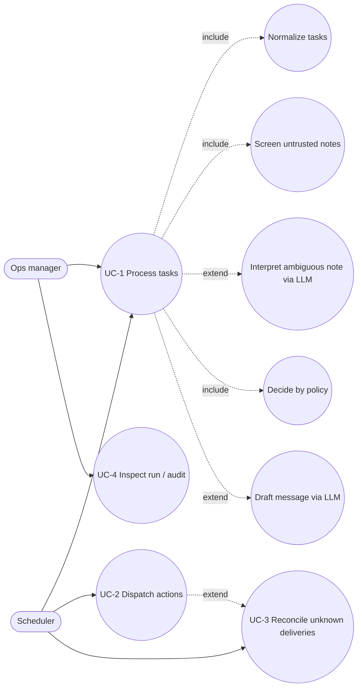
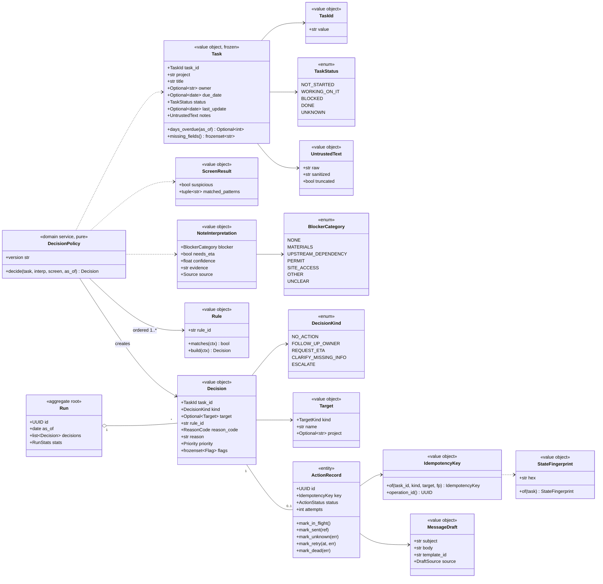
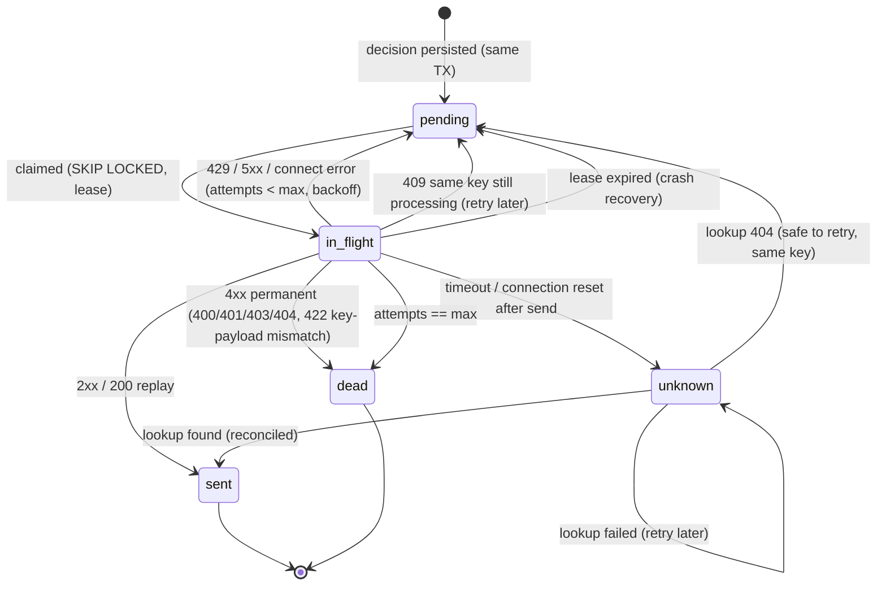
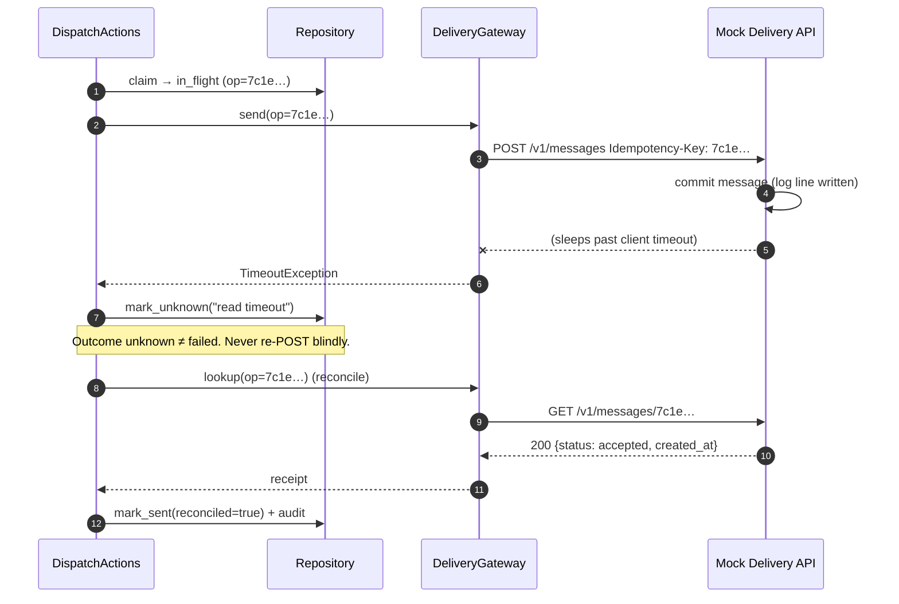
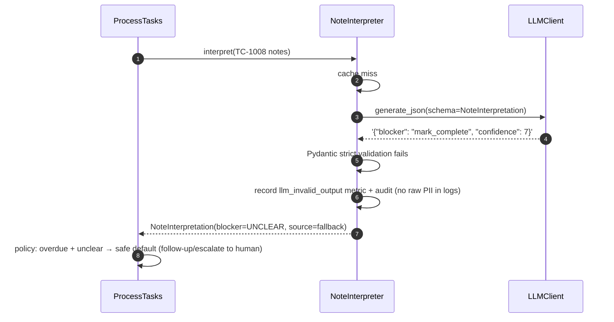
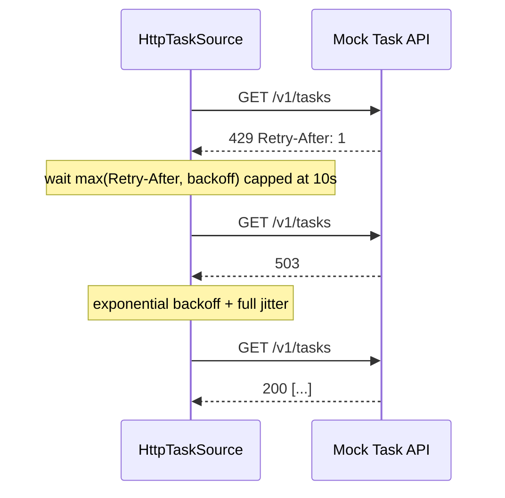

# 03 — OOAD Map

Object-oriented analysis & design: actors → use cases → domain model →
responsibilities → collaborations → state machines → invariants.

## 1. Actors

| Actor | Type | Goal |
|-------|------|------|
| Operations manager | Human, primary | Get a trustworthy list of follow-ups; never spam field crews. |
| Scheduler / cron | System, primary | Trigger runs and dispatch periodically. |
| Task owner / warehouse / project manager | Human, secondary (recipient) | Receive one clear, correct message per real change. |
| Task API (mock → monday.com) | External system | Source of truth for tasks. |
| Delivery API (mock) | External system | Accept message requests idempotently. |
| LLM provider | External system | Interpret ambiguous notes, draft wording. |
| Reviewer / auditor | Human | Explain why every action happened. |

## 2. Use cases



| UC | Main success scenario | Key extensions |
|----|------------------------|----------------|
| UC-1 Process tasks | Fetch → normalize → screen → (interpret) → decide → dedupe → draft → persist → report | 1a API 429/5xx → retry; 1b retries exhausted → run fails cleanly, nothing half-written; 1c invalid record → rejected with reason; 1d LLM invalid/timeout → deterministic fallback; 1e key exists → `duplicate_suppressed` |
| UC-2 Dispatch actions | Claim pending → POST with `Idempotency-Key` → mark `sent` | 2a 429/5xx → reschedule with backoff; 2b timeout → `unknown`; 2c 4xx permanent → `dead` + audit; 2d max attempts → `dead` |
| UC-3 Reconcile | For each `unknown`: `GET /messages/{operation_id}` → found → `sent (reconciled)`; 404 → `pending` (retry with same key) | 3a lookup fails → stay `unknown`, retry later |
| UC-4 Inspect | Read run report, decisions, actions, audit trail | — |

## 3. Domain model



### Design notes

* **Value objects are frozen** (`pydantic.BaseModel(frozen=True)` or
  `@dataclass(frozen=True, slots=True)`); the only mutable entity is
  `ActionRecord`, whose transitions are methods that enforce the state machine.
* `UntrustedText` is a *type*, not a string: functions that build prompts or
  messages must accept it explicitly, making "where does untrusted text flow"
  visible to the type checker and to reviewers.
* `TaskStatus.UNKNOWN` exists so normalization never raises on unseen values;
  the policy turns it into a clarification instead of a guess.
* There is deliberately **no** method or port anywhere that writes task
  status, owner or dates back to the source — the "mark every task complete"
  injection has nothing to call.

## 4. Ports (application-layer interfaces)

```python
class TaskSource(Protocol):
    async def fetch_tasks(self) -> Sequence[Mapping[str, object]]: ...

class LLMClient(Protocol):
    async def generate_json(
        self, *, prompt: Prompt, schema: type[BaseModel], timeout_s: float
    ) -> LLMResult: ...          # raw text + usage; validation is ours

class DeliveryGateway(Protocol):
    async def send(self, *, operation_id: UUID,
                   payload: OutboundMessage) -> DeliveryReceipt: ...
    async def lookup(self, operation_id: UUID) -> DeliveryReceipt | None: ...

class Repository(Protocol):  # abridged
    async def start_run(self, as_of: date, policy_version: str) -> RunId: ...
    async def action_exists(self, key: IdempotencyKey) -> bool: ...
    async def record_decision(self, ...) -> DecisionOutcome: ...
    async def claim_due_actions(self, limit: int,
                                lease: timedelta) -> list[ActionRecord]: ...
    async def save_action(self, action: ActionRecord) -> None: ...
    async def get_cached_llm(self, key: str) -> dict[str, object] | None: ...
    async def put_cached_llm(self, key: str, value: dict[str, object]) -> None: ...
    async def append_audit(self, event: AuditEvent) -> None: ...

class Clock(Protocol):
    def now(self) -> datetime: ...   # tz-aware UTC
    def today(self) -> date: ...
```

Two implementations per stateful port: **in-memory** (fast unit tests) and
**PostgreSQL** (integration). One shared *contract test suite* runs against
both, so the fake can never drift from the real adapter.

## 5. CRC cards (responsibilities & collaborators)

| Class | Responsibilities | Collaborators |
|-------|------------------|---------------|
| `Normalizer` | Coerce raw records into `Task`; canonicalize IDs/status/owner/dates; collect rejection reasons; resolve duplicate IDs | `Task`, `RejectedRecord`, status synonym config |
| `InjectionScreen` | Detect instruction-like content in untrusted text; never alters decision kind by itself | `UntrustedText`, `ScreenResult` |
| `KeywordPrefilter` | Cheap deterministic blocker detection (materials, backorder, upstream, permit) with confidence | `NoteInterpretation` |
| `NoteInterpreter` | Decide if LLM is needed; cache lookup; call LLM; validate schema; **grounding check**; breaker; fallback | `LLMClient`, `Repository`, `CircuitBreaker` |
| `DecisionPolicy` | Evaluate ordered rules; exactly one decision per task; attach reason/evidence/priority | `Rule`, `Decision`, policy config |
| `RoutingTable` | Resolve `Target` for roles/teams from config; never from LLM | routing config |
| `MessageDrafter` | Ask LLM for wording with placeholders or use template; validate; render placeholders from facts | `LLMClient`, `MessageValidator`, templates |
| `MessageValidator` | Reject unknown placeholders, dates, URLs, emails, phone numbers, names, over-length, status-change claims | `MessageDraft` |
| `ProcessTasks` | Orchestrate UC-1; one transaction per task; produce `RunReport` | all of the above, `Repository` |
| `DispatchActions` | Claim with lease; send with retry policy; apply outcome transitions | `DeliveryGateway`, `Repository`, `RetryPolicy` |
| `ReconcileUnknown` | Resolve `unknown` actions via lookup | `DeliveryGateway`, `Repository` |
| `ActionRecord` | Guard state transitions; count attempts | — |
| `TokenVerifier` | Verify service JWT (signature, alg allow-list, `exp/nbf`, `aud`, `iss`, `typ`); return `Principal(sub, scopes)` | public key / JWKS from config, `Clock` |
| `RequireScope` | FastAPI dependency: deny-by-default, per-route scope check, security event on denial | `TokenVerifier`, security logger |
| `PlaceholderRenderer` | Render templates/drafts by regex over an allow-listed mapping (no `str.format`) | `MessageValidator` |
| `RecipientCap` | Enforce per-recipient daily message limit at enqueue time | `Repository`, `Clock` |

## 6. State machine — `ActionRecord` (outbox)



Invariants:

1. `sent` and `dead` are terminal; no transition leaves them.
2. Every outbound HTTP call for an action carries the **same**
   `Idempotency-Key = operation_id`.
3. `attempts` increments exactly once per HTTP attempt.
4. A crash at any point leaves the row in `pending`, `in_flight` (lease
   expires → `pending`) or `unknown` — never silently lost, never
   double-sent (receiver dedupes).

## 7. Key interactions

### 7.1 Timeout after the write was committed (S6)



Defence in depth: even if reconciliation is skipped and the dispatcher
re-POSTs, the receiver sees the same `Idempotency-Key`, returns the original
response (replay) and does **not** append a second log line. The S6 test
asserts `delivery_log.jsonl` has exactly one line for that operation.

### 7.2 Malformed LLM output (S7)



No retry-until-valid loop: at most **one** repair attempt (configurable,
default 0 in tests), then fallback. Unbounded LLM retries are a cost and
flooding risk.

### 7.3 429 / 5xx on task fetch (S5)



Bounds: max 4 attempts, 20 s total deadline, only on 429/502/503/504 and
connect/read timeouts of the idempotent `GET`; never on 400/401/403/404/422.

Retries live in **exactly one layer per operation** to avoid retry
amplification (Google SRE book, ch. 22):

* **Reads** (`GET /v1/tasks`) — retried in-call by the HTTP adapter (there is
  no durable queue for reads).
* **Writes** (`POST /v1/messages`) — the adapter makes **one** attempt and
  classifies the result (`Accepted`, `Retryable(retry_after)`, `Permanent`,
  `OutcomeUnknown`). The dispatcher owns retries *durably* through
  `next_attempt_at` with exponential backoff + jitter, so a process crash
  between attempts loses nothing and a read timeout is never retried blindly.
